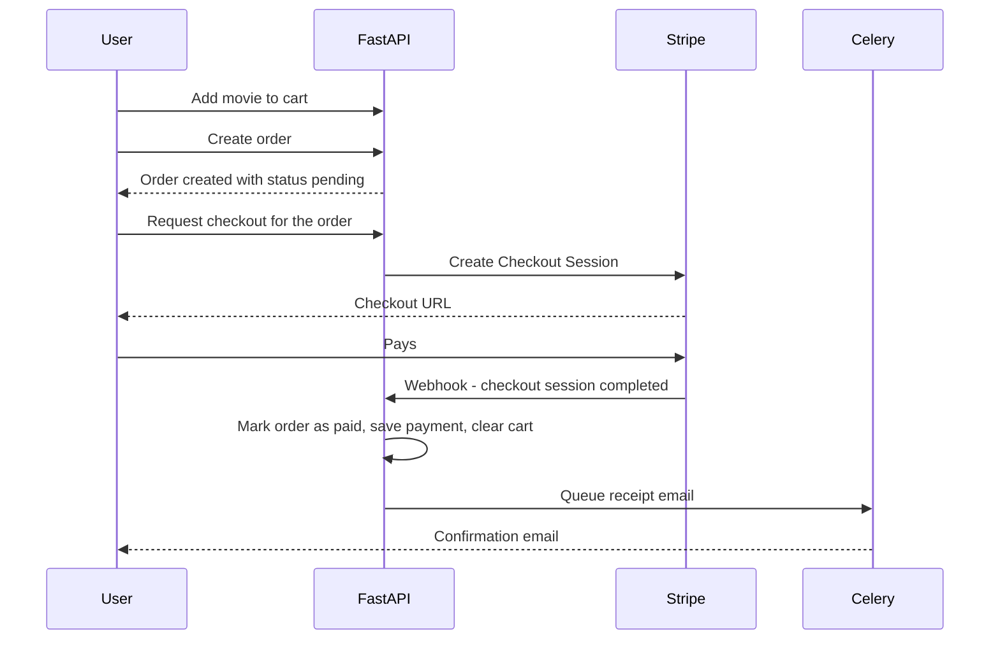

<div align="center">

# 🎬 Online Cinema Backend API

**A secure, scalable backend for a digital platform where users browse, rate, and purchase access to movies and video materials.**


[Quick Start](#-quick-start) •
[Features](#-features) •
[Security](#-security--production-hardening) •
[API Reference](#-api-reference) •
[Testing](#-testing--quality) •
[CI/CD](#-cicd-pipeline)

</div>

---

## 📖 Table of Contents

- [Tech Stack](#-tech-stack)
- [Features](#-features)
- [Security & Production Hardening](#-security--production-hardening)
- [Project Structure](#-project-structure)
- [Quick Start](#-quick-start)
- [API Documentation Access](#-api-documentation-access)
- [API Reference](#-api-reference)
- [Background Tasks](#-background-tasks)
- [Testing & Quality](#-testing--quality)
- [CI/CD Pipeline](#-cicd-pipeline)

---

## 🧰 Tech Stack

| Layer | Technology |
|---|---|
| **Framework** | FastAPI (Python 3.11, asynchronous ASGI) |
| **Database & ORM** | PostgreSQL 16, SQLAlchemy 2.0 (`asyncpg` async driver), Alembic (automated migrations) |
| **Task Queue & Cache** | Celery, Celery Beat, Redis 7 |
| **Object Storage** | MinIO / AWS S3 (S3-compatible, avatars and media) |
| **Payments** | Stripe (Checkout Sessions + Webhooks) |
| **Mail Testing** | Mailpit (local SMTP server with web UI) |
| **Dependencies** | Poetry |
| **Containers** | Docker & Docker Compose |
| **Quality** | Pytest, pytest-asyncio, pytest-cov, Black, Flake8, Mypy |
| **CI/CD** | GitHub Actions |

---

## ✨ Features

### 🔐 1. Authorization & Authentication

- **Email verification** — registration sends a secure 24-hour activation link.
- **Token cleanup** — Celery Beat purges expired activation tokens every hour.
- **Resend activation** — request a fresh 24-hour link if the previous one expired.
- **JWT token pair** — short-lived `access_token` + `refresh_token` stored in the database.
- **Session revocation** — logout deletes the refresh token from the database, invalidating the session.
- **Password management** — change password (requires current one) or reset via email without knowing the old one.
- **Strict password policy** — min. 8 characters, upper- and lowercase letters, a digit, and a special character.
- **RBAC** — three roles: `USER`, `MODERATOR`, `ADMIN`. Admins can reassign roles and manually activate accounts.
- **Profiles & S3 avatars** — first/last name, gender (`MAN`/`WOMAN`), birthday, bio, avatar upload to MinIO/S3.

### 🎞️ 2. Movies Catalog

- **Browsing** — server-side pagination; sort by price, release year, IMDb rating, popularity (votes).
- **Search & filters** — search across title, description, stars, directors; filter by year range, IMDb range, genres, certification.
- **Genre aggregation** — public genre list with real-time movie counts.
- **User interactions** — 1–10 ratings, likes/dislikes, favorites (with full filtering and search), nested comments and replies with author notifications.
- **Moderator safeguards** — CRUD for movies, genres, stars, directors, and certifications.
  - 🛑 *Deletion protection* — a movie purchased by at least one user can't be deleted.
  - ⚠️ *Cart warning* — moderators are warned when deleting a movie that sits in active carts.

### 🛒 3. Shopping Cart

- **1:1 user cart** — one dedicated cart per registered user, preventing item duplication.
- **Duplicate & repeat purchase prevention** — rejects movies already in the cart or previously purchased.
- **Item breakdown** — title, price, release year, and genres.
- **Moderator inspection** — staff can inspect user carts for troubleshooting and analysis.

### 📦 4. Orders

- **Cart checkout** — creates an order from the active cart, locking prices into `OrderItem.price_at_order` for historical audit accuracy.
- **Lifecycle tracking** — `pending` → `paid` or `canceled`.
- **Cancellation** — users can cancel pending orders; paid orders require a refund workflow.
- **Validation** — non-empty cart, no duplicate pending orders with overlapping movies, price revalidation.

### 💳 5. Payments (Stripe)

- **Stripe Checkout** — generates sessions that redirect to the Stripe payment page.
- **Webhook processing** — asynchronously handles `checkout.session.completed`: marks the order as `paid`, records `Payment` and `PaymentItem`, clears the cart, and triggers a confirmation email via Celery.
- **Purchased movies** — real-time list of everything the user has bought (`GET /api/v1/movies/purchased`).
- **Local simulation** — endpoint to simulate successful payments for offline and staging tests.

### 🔄 Order Flow



---

## 🛡️ Security & Production Hardening

The application enforces a strict separation between **development** and **production** environments.

### 🧪 Development convenience defaults

- With `ENVIRONMENT=development` (the default for local setup), convenience defaults are allowed: `DEBUG=True`, local Mailpit SMTP, local MinIO over HTTP.
- Default Swagger credentials (`admin` / `cinema_admin`) allow rapid local API exploration.

### 🚨 Fail-fast production validation

With `ENVIRONMENT=production`, the app runs startup validation in `src/core/config.py` and **refuses to boot** if any default development credentials are detected:

| Variable | Requirement |
|---|---|
| `SECRET_KEY` | Strong, randomly generated secret, 32+ characters |
| `POSTGRES_PASSWORD` | Must not be `cinema_password` |
| `MINIO_SECRET_KEY` | Must not be `minioadmin` |
| `STRIPE_SECRET_KEY` | Must not be a test/dummy key |
| `DOCS_PASSWORD` | Must not be the default `cinema_admin` |

> [!IMPORTANT]
> In production, `DEBUG` must be `False`, `MINIO_SECURE` should be `True` (HTTPS S3 storage), and real SMTP credentials must be configured.

---

## 🗂️ Project Structure

```text
.
├── .github/
│   └── workflows/
│       └── ci.yml             # GitHub Actions CI/CD pipeline
├── alembic/                   # Database migrations configuration & versions
├── src/
│   ├── core/                  # Configuration, database engine, security, storage, Celery
│   │   ├── celery_app.py
│   │   ├── config.py          # Settings with fail-fast production validation
│   │   ├── database.py
│   │   ├── security.py
│   │   └── storage.py
│   ├── modules/
│   │   ├── accounts/          # User auth, profiles, tokens, RBAC
│   │   ├── cart/              # Shopping cart & cart items
│   │   ├── movies/            # Movies catalog, genres, stars, ratings
│   │   ├── orders/            # Customer orders & order items
│   │   └── payments/          # Stripe checkout, webhooks, transactions
│   ├── tasks/                 # Celery tasks (email sending, token cleanup)
│   └── main.py                # FastAPI entrypoint, lifecycle & documentation protection
├── tests/                     # Unit, integration, and E2E test suites
├── .env.example               # Environment variables template
├── setup.cfg                  # Linter configurations (Flake8 & Mypy)
├── docker-compose.yml         # Multi-container orchestration with auto-migrations
├── Dockerfile                 # Application container specification
├── pyproject.toml             # Poetry dependencies and tools configuration
└── README.md
```

---

## 🚀 Quick Start

### 1️⃣ Clone and configure

```bash
git clone https://github.com/Sergio-zt/online-cinema.git
cd online-cinema
cp .env.example .env
```

### 2️⃣ Launch services

```bash
docker compose up -d --build
```

> [!NOTE]
> Whenever you modify `.env`, **don't** use `docker compose restart`.
> Run `docker compose up -d` instead to recreate containers with the updated variables.

### 3️⃣ Automated database migrations

Migrations run **automatically on container startup**, before FastAPI begins handling requests (`alembic upgrade head && uvicorn ...` in `docker-compose.yml`). The service waits for the PostgreSQL healthcheck before migrating.

To run migrations manually or inspect revision history:

```bash
docker compose exec web alembic upgrade head
```

### 4️⃣ Service ports & access

| Service | URL |
|---|---|
| ⚡ FastAPI Web API | http://localhost:8000 |
| 📘 Swagger Docs | http://localhost:8000/docs |
| 📕 ReDoc | http://localhost:8000/redoc |
| 📧 Mailpit (email inbox) | http://localhost:8025 |
| 🗄️ MinIO S3 Console | http://localhost:9001 (`minioadmin` / `minioadmin`) |
| 🐘 PostgreSQL | `localhost:5432` |
| 🧠 Redis | `localhost:6379` |

---

## 🔒 API Documentation Access

Interactive API docs (`/docs`, `/redoc`, `/openapi.json`) are protected with **HTTP Basic Authentication**.

| Resource | URL |
|---|---|
| Swagger UI | http://localhost:8000/docs |
| ReDoc | http://localhost:8000/redoc |
| OpenAPI JSON | http://localhost:8000/openapi.json |

**Configuring credentials** — set `DOCS_USERNAME` and `DOCS_PASSWORD` via environment variables.

| | Default (development) |
|---|---|
| Username | `admin` |
| Password | `cinema_admin` |

> [!WARNING]
> In production, set custom values in `.env` to prevent unauthorized access to the API documentation. The default password is rejected by startup validation.

---

## 📡 API Reference

Legend: 🌐 public · 👤 authenticated user · 🛡️ Moderator/Admin · 👑 Admin only

<details>
<summary><b>👤 Accounts & Authentication</b> — <code>/api/v1/accounts</code></summary>

| Method | Endpoint | Description | Access |
|---|---|---|---|
| `POST` | `/register` | Register a new user. Body: `{"email": "...", "password": "..."}`. Returns `201 Created`; enqueues activation email via Celery | 🌐 |
| `GET` | `/activate?token={token}` | Activate account via the link from the verification email | 🌐 |
| `POST` | `/activate` | Activate account via JSON body `{"token": "..."}` | 🌐 |
| `POST` | `/resend-activation` | Request a new 24-hour activation link for inactive accounts | 🌐 |
| `POST` | `/login` | OAuth2 password flow (email goes in the `username` field). Returns `{access_token, refresh_token, token_type}` | 🌐 |
| `POST` | `/refresh` | Exchange a valid refresh token for a new access token | 🌐 |
| `POST` | `/logout` | Invalidate and revoke the current refresh token | 👤 |
| `POST` | `/change-password` | Change password (requires `old_password` and a compliant `new_password`) | 👤 |
| `POST` | `/password-reset/request` | Send a 1-hour password reset link to the registered email | 🌐 |
| `POST` | `/password-reset/confirm` | Reset password with the reset token, no old password needed | 🌐 |
| `GET` | `/me` | Profile of the current user | 👤 |
| `PUT` | `/me/profile` | Update `first_name`, `last_name`, `gender`, `date_of_birth`, `info` | 👤 |
| `POST` | `/me/avatar` | Upload avatar (`.png`, `.jpg`, `.webp`) to MinIO/S3 and update profile | 👤 |
| `PATCH` | `/admin/users/{user_id}/group` | Reassign role (`USER`, `MODERATOR`, `ADMIN`) | 👑 |
| `PATCH` | `/admin/users/{user_id}/activate` | Manually activate a user account | 👑 |

</details>

<details>
<summary><b>🎞️ Movies Catalog</b> — <code>/api/v1</code></summary>

| Method | Endpoint | Description | Access |
|---|---|---|---|
| `GET` | `/genres` | All genres with aggregated movie counts | 🌐 |
| `GET` | `/movies` | Catalog browsing with pagination and multi-parameter filtering (see below) | 🌐 |
| `GET` | `/movies/{movie_id}` | Movie details with aggregated rating and reaction counts | 🌐 |
| `GET` | `/movies/favorites` | Favorite movies with full search and filters | 👤 |
| `POST` | `/movies/{movie_id}/favorite` | Add to favorites | 👤 |
| `DELETE` | `/movies/{movie_id}/favorite` | Remove from favorites | 👤 |
| `GET` | `/movies/purchased` | Movies successfully purchased by the user | 👤 |
| `POST` | `/movies/{movie_id}/rate` | Rate 1–10 (upsert) | 👤 |
| `POST` | `/movies/{movie_id}/reaction` | Like or dislike (`is_like: true/false`) | 👤 |
| `POST` | `/movies/{movie_id}/comments` | Top-level comment or nested reply (`parent_id`); notifies parent comment author | 👤 |
| `POST` | `/comments/{comment_id}/like` | Like a comment and notify its author | 👤 |
| `POST` | `/movies` | Create movie with genres, directors, stars, and certification | 🛡️ |
| `PUT` | `/movies/{movie_id}` | Update movie attributes | 🛡️ |
| `DELETE` | `/movies/{movie_id}` | Delete movie. Blocked if purchased; warns if in active carts (`confirm_in_cart=true` required) | 🛡️ |
| `POST` | `/genres`, `/stars`, `/directors`, `/certifications` | CRUD for catalog metadata | 🛡️ |

**`GET /movies` query parameters**

| Parameter | Description |
|---|---|
| `page`, `page_size` | Pagination |
| `search` | Title, description, actor, director |
| `genre_id` | Filter by genre |
| `year_from`, `year_to` | Release year range |
| `imdb_min`, `imdb_max` | IMDb rating range |
| `certification_id` | Filter by certification |
| `sort_by` | `price_asc`, `price_desc`, `year_asc`, `year_desc`, `imdb_asc`, `imdb_desc`, `votes_desc` |

</details>

<details>
<summary><b>🛒 Shopping Cart</b> — <code>/api/v1/cart</code></summary>

| Method | Endpoint | Description | Access |
|---|---|---|---|
| `GET` | `/cart` | Active cart with items, prices, genres, release year, total items count, and total price | 👤 |
| `POST` | `/cart/items` | Add a movie. Rejects duplicates and already purchased movies with `400 Bad Request` | 👤 |
| `DELETE` | `/cart/items/{movie_id}` | Remove a specific movie | 👤 |
| `DELETE` | `/cart` | Clear the cart entirely | 👤 |
| `GET` | `/cart/admin/users/{user_id}` | Inspect any user's cart | 🛡️ |

</details>

<details>
<summary><b>📦 Orders</b> — <code>/api/v1/orders</code></summary>

| Method | Endpoint | Description | Access |
|---|---|---|---|
| `POST` | `/orders` | Create an order from the cart; locks prices into `OrderItem.price_at_order`, status `pending`, validates against duplicate pending orders | 👤 |
| `GET` | `/orders` | Order history of the authenticated user | 👤 |
| `GET` | `/orders/{order_id}` | Single order details | 👤 |
| `POST` | `/orders/{order_id}/cancel` | Cancel an unpaid pending order | 👤 |
| `GET` | `/orders/admin/all` | Filter all orders by `user_id`, `status`, `date_from`, `date_to` | 🛡️ |

</details>

<details>
<summary><b>💳 Payments</b> — <code>/api/v1/payments</code></summary>

| Method | Endpoint | Description | Access |
|---|---|---|---|
| `POST` | `/payments/checkout/{order_id}` | Start a Stripe Checkout Session and return the checkout URL | 👤 |
| `POST` | `/payments/webhook` | Stripe webhook (`checkout.session.completed`): order → `paid`, creates `Payment` and `PaymentItem`, clears cart, sends confirmation email | 🌐 Stripe |
| `POST` | `/payments/simulate-success/{order_id}` | Local testing endpoint simulating successful payment | 👤 |
| `GET` | `/payments` | User transaction history | 👤 |
| `GET` | `/payments/admin/all` | Filter platform payment transactions | 🛡️ |

</details>

---

## ⏱️ Background Tasks

Powered by **Celery** and **Celery Beat**.

| Task | Description |
|---|---|
| `src.tasks.email.send_email_task` | Asynchronous SMTP dispatch for activation links, password resets, and payment receipts |
| `src.tasks.cleaners.clean_expired_activation_tokens` | Periodic task run **every hour** by Celery Beat to remove expired activation tokens |

---

## 🧪 Testing & Quality

**Run the test suite**

```bash
docker compose exec web pytest -v
```

**Coverage report**

```bash
docker compose exec web pytest --cov=src --cov-report=term-missing
```

**Linters and type checking**

```bash
# Check code formatting with Black
docker compose exec web black --check src tests

# Run Flake8 linter
docker compose exec web flake8 src tests

# Run static type checking with Mypy
docker compose exec web mypy src
```

---

## ⚙️ CI/CD Pipeline

Configured in `.github/workflows/ci.yml`. On every push or pull request to `main`:

1. 🐘 Spawns ephemeral **PostgreSQL 16** and **Redis** service containers.
2. 📦 Installs Poetry dependencies and caches the virtualenv.
3. 🧹 Runs **Black**, **Flake8**, and **Mypy** checks.
4. 🗃️ Executes database migrations via **Alembic**.
5. ✅ Runs the full test suite with coverage report generation and artifact upload.
6. 🚢 Deploys to **AWS EC2** when merged into `main`.

---

<div align="center">

Made with ❤️ and FastAPI

</div>